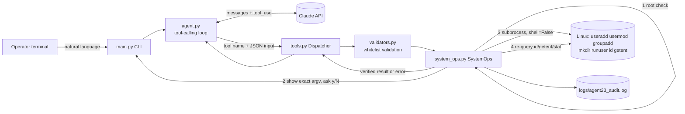

# Architecture



```
 Operator --> CLI --> Agent loop <--> Claude API
                          |
                          v  tool_use
                     Dispatcher --> Validators --> SystemOps
                                                    | root check
                                                    | operator confirm (exact argv)
                                                    | subprocess (no shell)
                                                    | verify via id/getent/stat
                                                    v
                                         Linux + audit log
```

Trust boundary: Claude output is untrusted. Validation, confirmation, root check and
verification are enforced in Python, not by the prompt.
